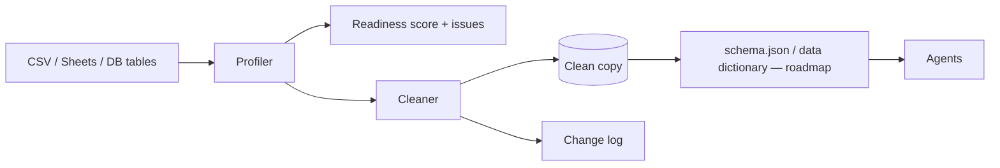

# Architecture — data-kondo

## 1. Scope
Profile messy tabular data, score how usable it is by agents, and clean it deterministically.
**MVP:** CSV profiler (type inference, nulls, formats), agent-readiness score, rule-based cleaner with change log.
**Product:** connectors (Drive, SharePoint, databases), entity resolution, scheduled tidy jobs, data dictionary for agents.

## 2. System context

## 3. Components
| Module | Responsibility | Status |
|---|---|---|
| `infer_type` | Per-value type (int, float, bool, email, date, phone, text), ordered by specificity | MVP |
| `profile` | Column stats: dominant type, mix, null rate, null spellings, distinct, whitespace, date formats | MVP |
| `readiness` | 0–100 score with point deductions per issue class | MVP |
| `clean` | Header snake_case + dedupe, null unification, type-aware normalisation, row dedupe (exact or by key) | MVP |
| Entity resolution | Fuzzy-match records across files (blocking + Jaro-Winkler) | Roadmap |

## 4. Design decisions
- **Profile first, then clean using the profile.** Normalisation is driven by each column's
  *dominant* type, so a stray value doesn't change how the column is treated.
- **Never destructive in place.** The output is a new file plus a human-readable change log.
  Data owners need to trust the tool before they automate it.
- **Dedupe after normalisation.** Rows that differ only in null spelling (`N/A` vs `null`) are true
  duplicates, and the tests cover exactly this.
- **Ambiguous dates** (`01/07/2026`): formats are tried in a fixed order (US before EU).
  *Trade-off:* the order is locale-sensitive, so the product infers it per column from values with
  a day above 12.

## 5. Future production architecture (not shipped)
- Workers process files in a streaming fashion with chunked profiling (reservoir sample for
  distinct counts, exact counts for nulls). Results go to Postgres and cleaned files to object storage.
- Connector framework: OAuth per source, a change cursor per table, and an idempotent re-run per version.
- Note: none of the above is in this release — the shipped product profiles and cleans CSVs
  locally and over the built-in web app. Connectors, Postgres, and object storage are roadmap.

## 6. Security
Data stays in the customer's tenant bucket, and logs record cell counts, never cell values.

## 7. Scaling
Profiling is O(rows × cols). Huge tables (over 10M rows) go to Polars/DuckDB backends behind the
same interface.

## 8. Risks
Over-eager normalisation, such as phone numbers stored as IDs. Per-column overrides and a dry-run
diff mode mitigate that.
